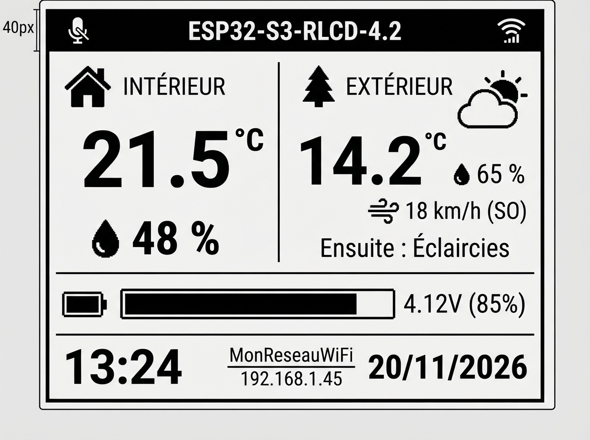

# ESP32-S3-RLCD-4.2 — ESPHome Configuration

🌐 **[English](#-english)** | **[Français](#-français)**



---

## 🇬🇧 English

A complete ESPHome YAML configuration for the **Waveshare ESP32-S3-RLCD-4.2** development board (4.2" 400×300 Reflective LCD display).

This setup turns the board into a low-power indoor/outdoor weather station and a Home Assistant Voice Assistant node.

### ✨ Features

* **4.2" Reflective LCD (`st7305`)**: Uses the native ESPHome `st7305` display driver (ESPHome **2026.11.0+**).
* **Indoor Climate**: Reads local temperature and humidity via the onboard **SHTC3** I2C sensor.
* **Outdoor Weather**: Fetches outdoor temperature, humidity, wind speed/direction, and weather condition icons directly from a Home Assistant `weather` entity, plus the next upcoming weather change (`Ensuite : à xh`).
* **Network & Status Header/Footer**: Displays Wi-Fi connection status (RSSI), active/muted microphone indicator, connected SSID, IP address, and RTC-backed date/time (`pcf85063`).
* **Battery Monitoring & Deep Sleep**: Tracks battery voltage and percentage with a dynamic progress bar, plus configurable deep sleep cycles controlled from Home Assistant.
* **Home Assistant Voice Assistant**: Supports onboard wake word detection (`micro_wake_word` with *"Okay Nabu"*), ES8311 DAC audio playback, ES7210 ADC microphone input, and hardware buttons.

### 📋 Requirements

* **Hardware**: [Waveshare ESP32-S3-RLCD-4.2](https://waveshare.com)
* **ESPHome**: Version **2026.11.0** or newer (required for native `st7305` support).
* **Fonts**: Place `materialdesignicons-webfont.ttf` inside your ESPHome `fonts/` directory.

### ⚙️ Configuration & Customization

Before compiling and flashing `esp32s3rlcd.yaml`, update the following parameters to match your environment:

1. **`secrets.yaml`** — Add your Wi-Fi credentials:
   ```yaml
   wifi_ssid: "Your_WiFi_SSID"
   wifi_password: "Your_WiFi_Password"
   ```

2. **Static IP Address** — Update or remove the `manual_ip` section under `wifi:` (add `dns1:` if domain resolution is needed):
   ```yaml
   wifi:
     manual_ip:
       static_ip: 192.168.0.102
       gateway: 192.168.0.254
       subnet: 255.255.255.0
       dns1: 192.168.0.254
   ```

3. **Home Assistant Local URL (Required for TTS Audio)** — In Home Assistant, go to **Settings → System → Network** and set your local IP address under **Local Network** (e.g., `http://0.xxx`). Without this, Home Assistant may send an external URL that the ESP32 cannot reach locally.

4. **Home Assistant Entities**:
   * **Weather Entity**: Update `.variables` at the top of the file:
     ```yaml
     .variables:
       - &weather_entity "weather.city"
     ```
   * **OTA Mode Helper**: Create an `input_boolean` in Home Assistant to block deep sleep during updates, and set its ID under `binary_sensor:`:
     ```yaml
     - platform: homeassistant
       name: "OTA Mode"
       id: ota_mode
       entity_id: input_boolean.ota_mode
     ```

### 🔘 Hardware Controls

| Pin | Function | Action |
| :--- | :--- | :--- |
| **GPIO0** (`Boot`) | Push-to-Talk | Hold to start Voice Assistant, release to stop |
| **GPIO18** (`Key`) | Mute / Wakeup | Toggles microphone mute state; also wakes the ESP32 from deep sleep |

### 🔋 Deep Sleep Behavior

* By default, **Prevent Sleep** is enabled (`RESTORE_DEFAULT_ON`) so the Voice Assistant remains responsive.
* Turn off **Prevent Sleep** in Home Assistant to enable battery-saving deep sleep cycles (duration configurable via the **Sleep Duration** entity in hours).
* Enabling **OTA Mode** in Home Assistant automatically prevents deep sleep on boot for reliable wireless updates.

### 🌦️ Home Assistant Sensor for "Ensuite : à xh" (`sensor.meteo_prochain_changement`)

To display the time and weather icon for the next upcoming weather change in the **Outdoor** column, add this `template:` sensor to your Home Assistant `configuration.yaml` (replace `weather.forecast_home` with your own weather entity):

```yaml
template:
  - trigger:
      - trigger: time_pattern
        minutes: "/15"
      - trigger: state
        entity_id: weather.forecast_home
      - trigger: homeassistant
        event: start
    action:
      - action: weather.get_forecasts
        target:
          entity_id: weather.forecast_home
        data:
          type: hourly
        response_variable: hourly_forecast
    sensor:
      - name: "Meteo Prochain Changement"
        unique_id: meteo_prochain_changement
        icon: mdi:weather-partly-cloudy
        state: >
          
          
          
          
            
              {% set hour = as_local(as_datetime(item.datetime)).strftime('%Hh') %}
              
              
            
          
          {{ ns.result }}
```

> **How it works**: Every 15 minutes (or whenever the weather entity updates), Home Assistant scans the next 24 hourly forecasts and outputs the first hour where the weather condition changes (e.g., `15h rainy`), which the ESP32 automatically renders as **`Ensuite : à 15h`** alongside the matching weather icon.

---

## 🇫🇷 Français

Une configuration YAML ESPHome complète pour la carte de développement **Waveshare ESP32-S3-RLCD-4.2** (écran LCD réflectif 4,2" 400×300).

Ce projet transforme la carte en station météo intérieure/extérieure basse consommation et en satellite vocal pour Home Assistant.

### ✨ Fonctionnalités

* **Écran LCD Réflectif 4,2" (`st7305`)** : Utilise le pilote natif `st7305` d'ESPHome (**2026.11.0+**).
* **Climat intérieur** : Mesure la température et l'humidité locales via le capteur I2C intégré **SHTC3**.
* **Météo extérieure** : Récupère la température, l'humidité et les icônes météo depuis une entité `weather` de Home Assistant.
* **En-tête et pied de page complets** : Affiche l'état du Wi-Fi, l'icône micro muet, le SSID connecté, l'adresse IP, ainsi que l'heure et la date sauvegardées sur l'horloge RTC (`pcf85063`).
* **Suivi batterie & Deep Sleep** : Affiche la tension et le pourcentage de batterie avec barre de progression, et gère des cycles de veille profonde configurables depuis Home Assistant.
* **Assistant Vocal Home Assistant** : Détection du mot-clé *"Hey Jarvis"* (`micro_wake_word`), sortie audio via DAC ES8311, microphone via ADC ES7210 et boutons physiques.

### 📋 Prérequis

* **Matériel** : [Waveshare ESP32-S3-RLCD-4.2](https://waveshare.com)
* **ESPHome** : Version **2026.11.0** ou supérieure (requise pour le support natif du pilote `st7305`).
* **Polices** : Placez le fichier `materialdesignicons-webfont.ttf` dans votre dossier `fonts/` d'ESPHome.

### ⚙️ Configuration et personnalisation

Avant de compiler et flasher `esp32s3rlcd.yaml`, adaptez les éléments suivants à votre installation :

1. **`secrets.yaml`** — Ajoutez vos identifiants Wi-Fi :
   ```yaml
   wifi_ssid: "Votre_SSID_WiFi"
   wifi_password: "Votre_Mot_De_Passe_WiFi"
   ```

2. **Adresse IP statique** — Modifiez ou supprimez le bloc `manual_ip` sous `wifi:` selon votre réseau local :
   ```yaml
   wifi:
     manual_ip:
       static_ip: 192.168.0.102
       gateway: 192.168.0.254
       subnet: 255.255.255.0
   ```

3. **Entités Home Assistant** :
   * **Entité météo** : Modifiez l'ancre `.variables` en haut du fichier :
     ```yaml
     .variables:
       - &weather_entity "weather.forecast_maison"
     ```
   * **Mode OTA** : Créez une entrée `input_boolean` dans Home Assistant pour bloquer la veille profonde pendant les mises à jour, et renseignez son identifiant sous `binary_sensor:` :
     ```yaml
     - platform: homeassistant
       name: "OTA Mode"
       id: ota_mode
       entity_id: input_boolean.ota_mode
     ```

### 🔘 Boutons physiques

| Broche | Fonction | Action |
| :--- | :--- | :--- |
| **GPIO0** (`Boot`) | Push-to-Talk | Maintenir appuyé pour parler à l'assistant vocal, relâcher pour arrêter |
| **GPIO18** (`Key`) | Mute / Réveil | Active/désactive le micro (muet) ; réveille également l'ESP32 du *deep sleep* |

### 🔋 Gestion du Deep Sleep (Veille profonde)

* Par défaut, l'interrupteur **Prevent Sleep** est activé (`RESTORE_DEFAULT_ON`) afin que l'assistant vocal reste à l'écoute en permanence.
* Désactivez **Prevent Sleep** dans Home Assistant pour activer les cycles de veille profonde sur batterie (durée réglable en heures via l'entité **Sleep Duration**).
* L'activation de **OTA Mode** dans Home Assistant empêche automatiquement la mise en veille au démarrage afin de faciliter les mises à jour sans fil.

---

### 🌦️ Capteur Home Assistant pour « Ensuite : à xh » (`sensor.meteo_prochain_changement`)

Pour afficher l'heure et l'icône du prochain changement de météo dans la colonne **Extérieur**, ajoutez ce capteur `template:` dans le fichier `configuration.yaml` de Home Assistant (en remplaçant `weather.forecast_home` par votre entité météo) :

```yaml
template:
  - trigger:
      - trigger: time_pattern
        minutes: "/15"
      - trigger: homeassistant
        event: start
    action:
      - action: weather.get_forecasts
        target:
          entity_id: weather.forecast_home
        data:
          type: hourly
        response_variable: hourly_forecast
    sensor:
      - name: "Meteo Prochain Changement"
        unique_id: meteo_prochain_changement
        icon: mdi:weather-partly-cloudy
        state: >
          
          
          
          
            
              {% set hour = as_local(as_datetime(item.datetime)).strftime('%Hh') %}
              
              
            
          
          {{ ns.result }}
```

> **Fonctionnement** : Toutes les 15 minutes, Home Assistant parcourt les prévisions horaires à venir et renvoie la première heure où le temps change (ex. `15h rainy`), que l'ESP32 convertit automatiquement en **`Ensuite : à 15h`** accompagné de l'icône correspondante.


## 📄 License / Licence

This project is open-source and available under the MIT License.
